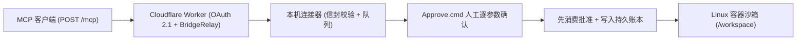

# AgentDock Bridge

[English](README.en.md) · [在线文档站](https://cybernova2333.github.io/agentdock-worker-remote/) · [文档站源码](docs-site/index.md) · [源码阅读指南](repo-docs/README.md)

[](LICENSE) [](package.json) [](wrangler.jsonc.example)

面向单人开发者的远程 MCP 桥接网关：通过 Cloudflare Workers 完成 OAuth 2.1 + PKCE 鉴权与请求中继，在 Windows 受保护连接器上等待人工逐参数批准后，交由只读 Linux Docker 沙箱执行工作区文件与命令操作。生产宿主强依赖 Windows DPAPI 与 NTFS ACL；非 Windows 系统支持云端 Worker 部署、容器构建与跨平台单元回归。

## 核心能力与执行链路

- **边缘 OAuth 2.1 与代次隔离**：云端拆分授权（`AuthCoordinator`）与设备长连接（`BridgeRelay`）双 SQLite Durable Objects，强制 PKCE `S256`、零脚本 CSP 同意书与刷新令牌家族撤销；修改所有者密码即自动切换代次、立即作废旧授权。
- **本机单次精确批准与防重放**：除只读环境、任务查询与停止工具外，敏感调用均按完整参数计算摘要并等待 `Approve.cmd` 人工输入口令放行；重试时先删除批准文件再写入 24 小时持久账本，避免重复副作用。
- **Linux 只读容器沙箱与文件守卫**：Bash 命令与文件工具均在丢弃多余权能、UID 1000、默认 `--network none` 的一次性容器中运行，逐级检查符号链接、多硬链接、非法 UTF-16 与 Windows 自定义 NTFS ACL。
- **清理故障安全退守**：一旦容器清理未能确认，连接器立即拒绝后续新任务，同时保留属主客户端对其他已有任务的查询与停止权限，不虚报安全退出。
- **受保护运行副本与固定工具链**：安装流程把本地运行时与配置隔离到 `%USERPROFILE%\.agentdock-bridge`，校验祖先路径权限、DPAPI 密钥与固定 Node 24.22.1 SHA-256 摘要，并清除 Node 预加载覆盖环境变量。



工具结果、错误码与心跳状态沿本地连接器主动建立的 `WSS /bridge` 长连接反向回传给云端中继，再作为 `/mcp` 的 HTTP 响应返回客户端；日常启停、状态探针与连接密码查看统一经 `%USERPROFILE%\.agentdock-bridge\{Start,Stop,Status,Password,Approve}.cmd` 执行（仓库根目录同名 `.cmd` 仅作转发）。

## 快速开始

以下为单机生产接入的最简主路径（在已登录 Cloudflare CLI 且 Docker Desktop `desktop-linux` 就绪的 Windows x64 环境执行；配置远端 MCP 客户端时填入 `https://<PUBLIC_ORIGIN>/mcp`）：

```powershell
pnpm install --frozen-lockfile && pnpm run check && pnpm test
Copy-Item wrangler.jsonc.example wrangler.jsonc   # 按实际域名修改 PUBLIC_ORIGIN
.\scripts\Setup.ps1 -Roots "<workspace-path>" -Origin "https://<your-bridge-domain>"
.\scripts\Secrets.ps1 -Action Upload
docker build -f container/Dockerfile -t agentdock-dev:2026-10-28 .
.\scripts\Install-Hardened.ps1 -Workspace "<workspace-path>"
pnpm run deploy
& "$env:USERPROFILE\.agentdock-bridge\Start.cmd"
```

其他运行模式与平台差异入口：

| 部署 / 使用场景 | 适用环境与行为摘要 | 详细文档入口 |
| --- | --- | --- |
| 云端网关与本地开发调试 | Cloudflare Worker 配置、Secrets 上传与 `wrangler dev --ip 127.0.0.1 --port 8797` | [起步概览](docs-site/docs/index.md) · [配置矩阵](docs-site/docs/configuration.md) |
| Windows 受保护安装与密钥轮换 | 默认 `%USERPROFILE%\.agentdock-bridge`、Node 固定摘要校验与双步密码轮换 | [配置与宿主安装](docs-site/docs/configuration.md) |
| 容器镜像、网络出网与工具契约 | 10 项 MCP 工具上限、`network: "outbound"` 开关及 `file-worker` 无执行边界 | [接口与扩展契约](docs-site/docs/contracts.md) |
| 公网验收与停机生命周期探针 | 显式运行 `acceptance-v2.mjs` / `verify-lifecycle.mjs` 验证 OAuth 与健康探针 | [配置与验收操作](docs-site/docs/configuration.md) · [修复快照](SECURITY-FIXES.md) |
| Linux / macOS 开发与回归验证 | 运行 `pnpm run check` 与 `pnpm test`（15 项 Windows/Docker 用例按条件自动跳过） | [源码阅读指南](repo-docs/README.md) · [常见边界与排错](docs-site/docs/faq.md) |

## 选型与边界 FAQ

- **为什么前端必须经由 Cloudflare Workers 而不是直接连接本地电脑？**

  远端 MCP 客户端要求公开且证书受信任的 HTTPS `/mcp` 与 OAuth 2.1 回调入口；Worker 充当边缘认证网关和反向 WebSocket 汇聚点，无需在家庭或办公路由器上开放任何入站端口。

- **是否支持多人共享或团队多租户使用？**

  不支持。网关所有授权令牌均映射单一宿主标识（`owner`）且只挂载一个显式工作区，多用户请各自独立部署 Worker 与本机连接器。

- **能否绕过 Cloudflare 或模型平台对数据的可见性？**

  不能。OAuth 凭证与 MCP 请求正文会经过 Cloudflare 边缘节点及调用方模型平台，本系统保护的是“未经批准不得触及本地环境”，而非端到端免信任密文传输。

- **使用 Docker 沙箱后，项目目录下的密钥是否安全？**

  容器对挂载工程具有读写权限以支持真实开发；已获批准的读操作或命令可访问工程内文件，且不可信文件内容中的提示词注入风险依然存在。

- **能否直接在 Linux 或 macOS 宿主机运行本地连接器？**

  当前生产凭据加载（`loadSecrets`）与安装检查显式限定 `win32` DPAPI 与 NTFS ACL；非 Windows 环境可运行纯 JS 与云端 Miniflare 回归，如需托管需自行替换密钥与宿主保护层。

## 文档与源码导航

| 读者目标 | 文档站入口 | 源码指南入口 |
| --- | --- | --- |
| 从零部署、配置参数与排查启动异常 | [1. 起步与配置部署](docs-site/docs/index.md) · [排错 FAQ](docs-site/docs/faq.md) | [开发与运行边界说明](repo-docs/README.md) |
| 核对 OAuth 2.1、MCP 工具上限与批准契约 | [2. 接口与扩展契约](docs-site/docs/contracts.md) | [云端网关](repo-docs/modules/cloud-oauth-and-relay.md) · [本地批准与账本](repo-docs/modules/local-approval-and-replay.md) · [容器与文件策略](repo-docs/modules/container-sandbox-and-file-policy.md) |
| 追踪一次请求流转、架构决策与源码改造入口 | [3. 原理与源码导览](docs-site/docs/architecture.md) · [请求走查](docs-site/docs/walkthrough.md) | [一次真实操作走查](repo-docs/walkthroughs/one-real-run.md) · [代码地图](repo-docs/code-map.md) · [术语表](repo-docs/glossary.md) |
| 审计安全修复快照、漏洞披露与提交规范 | [架构决策与历史对照](docs-site/docs/architecture.md#安全决策与演进迁移) | [修复与验证快照](SECURITY-FIXES.md) · [源码证据审计](repo-docs/references/source-evidence.md) · [安全说明](SECURITY.md) |

## 许可与致谢

本项目遵循 [GNU Affero General Public License v3.0](LICENSE)（`AGPL-3.0-only`）开源发布，仅作个人授权接入与工程研究之用；云端 OAuth 基础能力基于 `@cloudflare/workers-oauth-provider`，在线文档站采用 VitePress 构建，`repo-docs/` 源码指南随代码变更同步维护。提交贡献前请阅读[贡献指南](CONTRIBUTING.md)并遵守[安全策略](SECURITY.md)中的离线扫描与秘密隔离约定。
